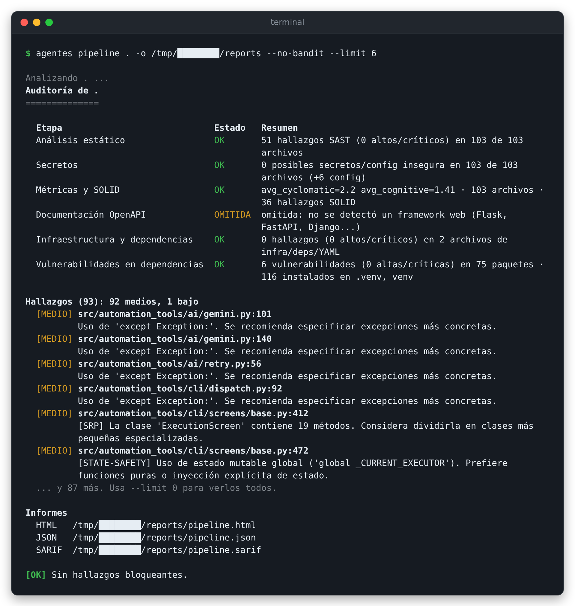
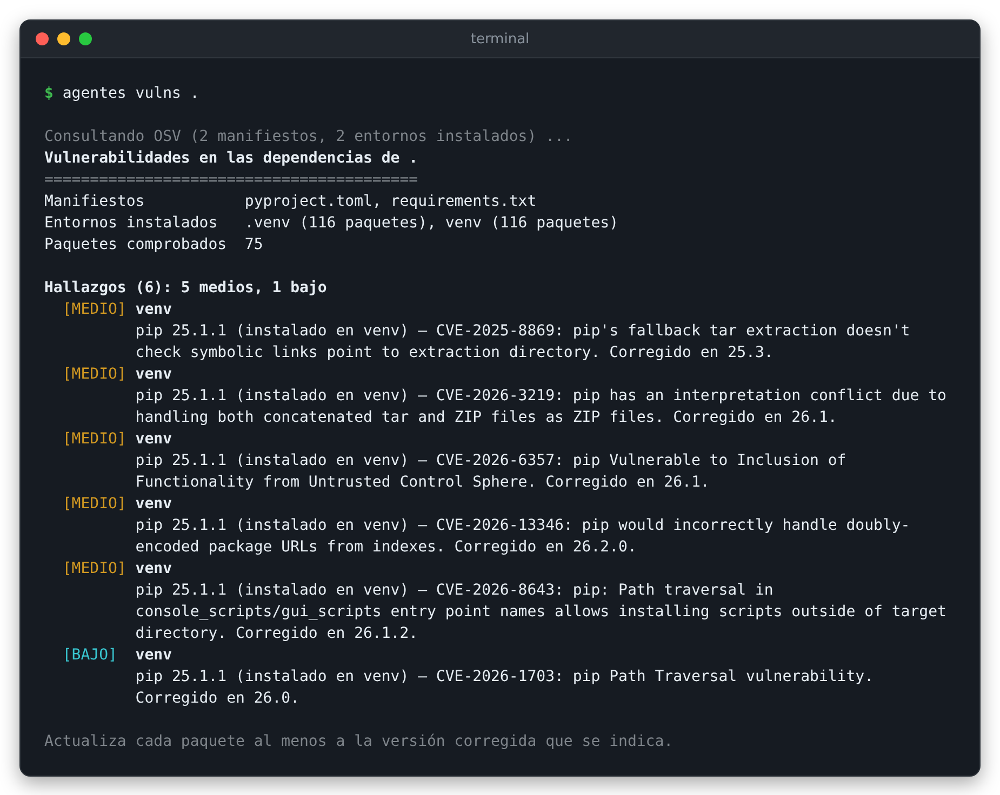
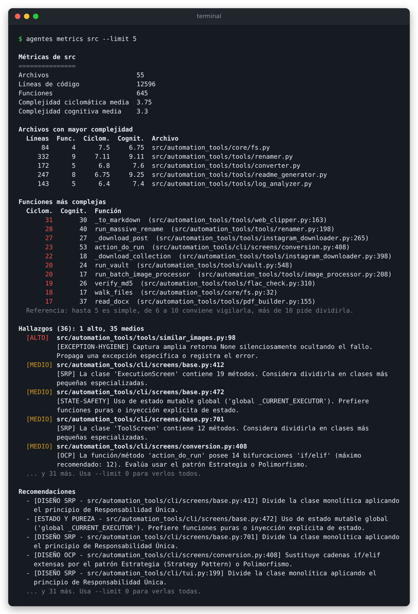
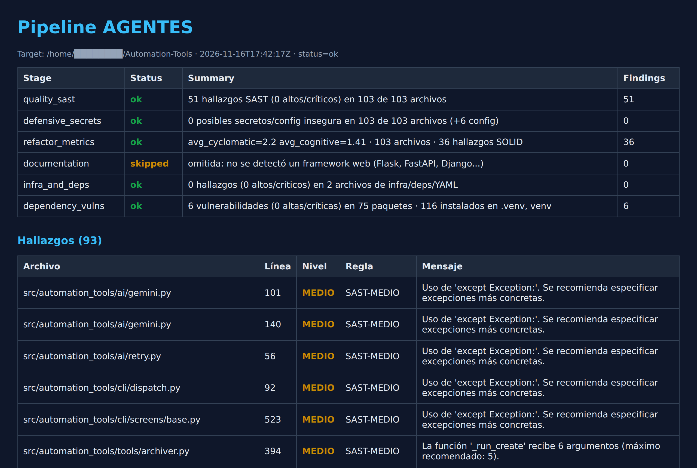

# Work-Agents

[English](README.md) | **Español**

Auditoría de seguridad, calidad y operación para proyectos Python con un solo comando: `agentes`.

[](https://github.com/kahz12/Work-Agents/actions/workflows/ci.yml)
[](pyproject.toml)
[](LICENSE)

Work-Agents reúne ocho agentes de DevSecOps, SRE y QA. Revisa el código y la configuración de un
proyecto, detecta secretos expuestos y dependencias con vulnerabilidades conocidas, genera
configuraciones endurecidas y produce informes en JSON, HTML y SARIF 2.1.0, el formato que GitHub
Code Scanning muestra de forma nativa.

> La interfaz de línea de comandos, sus mensajes y los informes están en inglés. Este documento
> y la [guía de usuario](docs/guia-de-usuario.md) explican en español cada comando y cada mensaje.

## Funciones

- **Análisis estático de Python** con un motor AST propio y, si está instalado, Bandit. Los
  hallazgos que varios motores detectan en la misma línea se funden en uno.
- **Secretos** en código y configuración: claves de AWS, GitHub, Slack, Stripe, Google, OpenAI,
  Anthropic y otros proveedores, claves privadas PEM, JWT y credenciales dentro de URL. Los
  valores siempre se muestran enmascarados.
- **Vulnerabilidades conocidas** en dependencias, consultadas en [OSV](https://osv.dev),
  incluidos los paquetes instalados en el entorno virtual del proyecto.
- **Infraestructura**: Dockerfiles, unidades systemd, manifiestos de Kubernetes, archivos `.env`,
  logs y cabeceras HTTP de seguridad.
- **Mantenibilidad**: complejidad ciclomática y cognitiva, heurísticas SOLID y antipatrones de
  rendimiento.
- **Generadores**: Docker Compose, Helm, Kubernetes, Dockerfile, systemd, Nginx, Caddy, GitHub
  Actions, GitLab CI, OpenAPI, Swagger UI, manuales en Markdown, diagramas Mermaid y suites de
  tests.
- **Integración continua**: códigos de salida previsibles, salida JSON y una línea base para que
  el CI falle solo con hallazgos nuevos.

## Instalación

Requiere Python 3.9 o posterior. El paquete se instala desde este repositorio:

```bash
git clone https://github.com/kahz12/Work-Agents.git
cd Work-Agents
pip install -e .            # instalación base
pip install -e ".[all]"     # con todos los extras
```

Las dependencias obligatorias son PyYAML y packaging (y tomli en Python 3.9 y 3.10). Los extras
son opcionales y mejoran motores que ya funcionan sin ellos:

| Extra    | Instala                | Efecto                                                     |
|----------|------------------------|------------------------------------------------------------|
| `crypto` | argon2-cffi, bcrypt    | Hashing de contraseñas con Argon2 o bcrypt en vez de PBKDF2. |
| `sast`   | bandit                 | Añade Bandit como segundo motor de análisis estático.      |
| `dev`    | pytest, ruff, pyflakes, coverage | Herramientas para los tests, el lint y la cobertura del proyecto. |
| `all`    | Todo lo anterior       |                                                            |

Sin instalar el paquete: `pip install -r requirements.txt` y
`python3 agentes_cli.py <comando>`.

## Primeros pasos

```bash
agentes doctor                        # comprobar la instalación
agentes pipeline ./mi_proyecto        # auditoría completa
agentes secrets .                     # solo secretos
agentes generate compose --service api --port 8000
```

`pipeline` ejecuta seis etapas, lista los hallazgos de más a menos graves y escribe sus informes
en `reports/` dentro del proyecto:



La tabla muestra cada etapa (análisis estático, secretos, métricas y SOLID, OpenAPI,
infraestructura y dependencias, vulnerabilidades en dependencias) con su estado (`OK`;
`SKIPPED`, omitida; o `FAILED`, fallida). Después vienen los hallazgos, de más a menos graves
(`HIGH` = alto, `MEDIUM` = medio). La [guía de usuario](docs/guia-de-usuario.md#cómo-leer-la-salida)
traduce todos los términos de la salida.

## Ejecución sobre un proyecto real

Las capturas de esta sección y de la anterior salen de una auditoría de
[Automation-Tools](https://github.com/kahz12/Automation-Tools), un proyecto Python de 103
archivos con dos entornos virtuales. Las rutas personales están ocultas.

`agentes vulns` comprueba los paquetes instalados en los entornos virtuales del proyecto, que
son los que de verdad se ejecutan, e indica la versión que corrige cada vulnerabilidad
(`Fixed in` = corregido en):



`agentes metrics` señala los archivos y funciones más complejos, los problemas de diseño y las
recomendaciones de refactorización:



`pipeline.html` resume las etapas y todos los hallazgos para revisarlos en el navegador:



## Comandos

`agentes` sin argumentos lista todos los comandos, y `agentes <comando> -h` muestra sus opciones.

| Grupo             | Comandos                                                      |
|-------------------|---------------------------------------------------------------|
| Analizar          | `pipeline`, `analyze`, `secrets`, `vulns`, `audit`, `metrics` |
| Generar y corregir | `generate`, `fix`                                            |
| Probar            | `test`, `testability`, `contract`                             |
| Operar            | `health`, `sla`, `serve`                                      |
| Utilidades        | `password`, `demo`, `list`, `doctor`, `help`                  |

Todos siguen las mismas convenciones: código de salida `0` si todo está bien, `1` si hay
hallazgos o fallos y `2` ante errores de uso; `--json` para scripts; `--offline` para no usar la
red; `--no-color` o `NO_COLOR` para desactivar el color.

## Integración continua

```yaml
- run: pip install "git+https://github.com/kahz12/Work-Agents.git"
- run: agentes pipeline . -o reports --baseline .agentes-baseline.json
- uses: github/codeql-action/upload-sarif@v3
  if: always()
  with:
    sarif_file: reports/pipeline.sarif
```

La línea base (`agentes pipeline . --write-baseline .agentes-baseline.json`) acepta los
hallazgos que ya existen para que el CI falle solo con los nuevos. Para aceptar un único
hallazgo con su motivo junto al código, añade `# agentes: ignore[REGLA]` en su línea; también se
respetan `# noqa` y `# nosec` con los códigos correspondientes.

## Red y privacidad

El código fuente nunca se envía a ningún sitio. Solo tres funciones contactan con servicios
externos, y `--offline` o `AGENTES_OFFLINE=1` las desactiva todas:

| Función                                   | Servicio               | Qué se envía                                |
|-------------------------------------------|------------------------|---------------------------------------------|
| Vulnerabilidades (`pipeline`, `analyze`, `vulns`, `fix`) | api.osv.dev | Nombre y versión de cada dependencia. |
| Elección de versiones (`fix`)             | pypi.org               | Nombre de cada paquete.                     |
| Contraseñas filtradas (`password check` y `hash`) | api.pwnedpasswords.com | Los 5 primeros caracteres del hash SHA-1. |

## Documentación

- [Guía de usuario](docs/guia-de-usuario.md): referencia completa de cada comando, catálogo de
  reglas, formatos de informe, integración continua y uso como biblioteca.
- [User guide](docs/user-guide.md): la misma guía en inglés.
- README de cada agente (en inglés): [`defensive`](agentes/defensive/README.md),
  [`quality`](agentes/quality/README.md), [`hardening`](agentes/hardening/README.md),
  [`refactor`](agentes/refactor/README.md), [`qa`](agentes/qa/README.md),
  [`sre`](agentes/sre/README.md), [`devops`](agentes/devops/README.md) y
  [`docs`](agentes/docs/README.md).

## Desarrollo

```bash
pip install -e ".[all]"
pytest -q
python3 test_all_agents.py
ruff check .

# Cobertura, como en el CI
coverage run -m pytest -q && coverage run --append test_all_agents.py && coverage report
```

Los tests no necesitan red. El [CI](.github/workflows/ci.yml) ejecuta el lint (ruff), la
comprobación de tipos (mypy, con `pip install mypy types-PyYAML`), la suite de tests en Python
3.9 a 3.13 con una cobertura mínima del 95 %, una autoauditoría del repositorio contra su propia
línea base y una comprobación del wheel instalado en un entorno limpio. La versión se define
solo en `agentes/__init__.py`.

## Licencia

MIT. Consulta [`LICENSE`](LICENSE).
