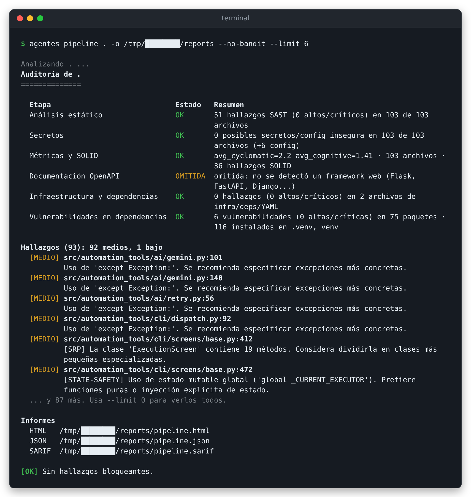
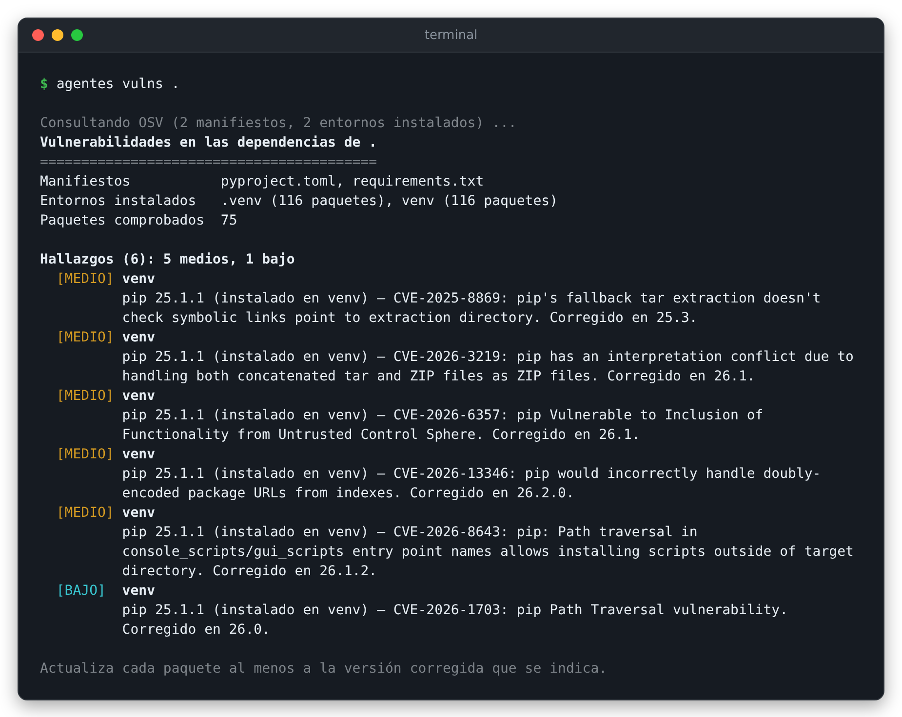
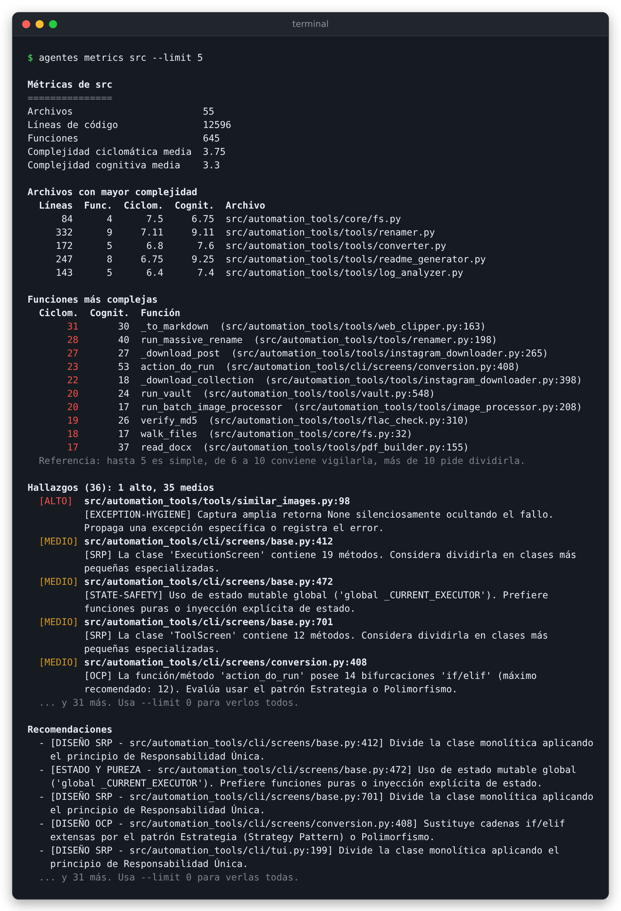
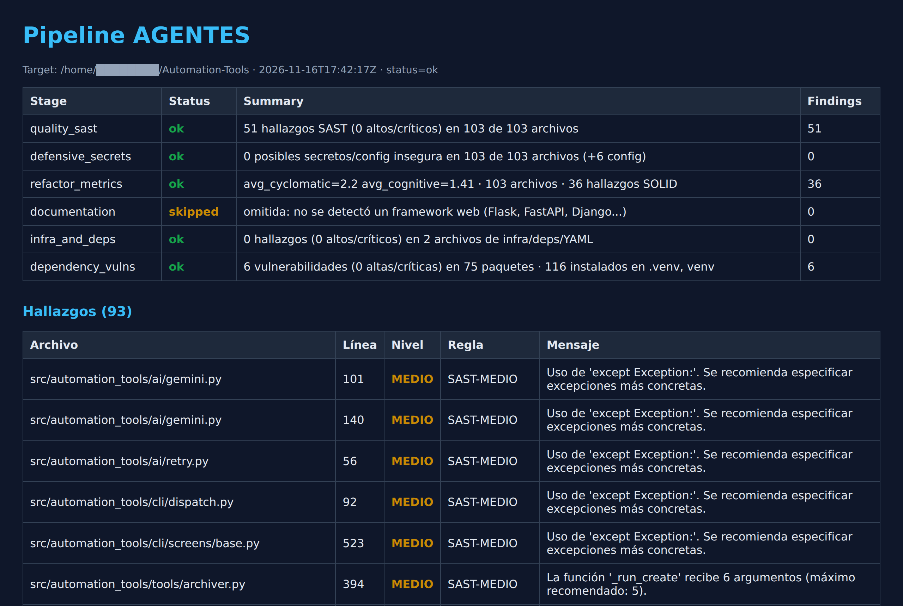

# Work-Agents

**English** | [Español](README.es.md)

Security, quality and operations auditing for Python projects from a single command: `agentes`.

[](https://github.com/kahz12/Work-Agents/actions/workflows/ci.yml)
[](pyproject.toml)
[](LICENSE)

Work-Agents bundles eight DevSecOps, SRE and QA agents. It reviews a project's code and
configuration, detects exposed secrets and dependencies with known vulnerabilities, generates
hardened configurations and produces reports in JSON, HTML and SARIF 2.1.0, the format GitHub
Code Scanning displays natively.

## Features

- **Python static analysis** with a built-in AST engine and, when installed, Bandit. Findings
  reported by several engines on the same line are merged into one.
- **Secrets** in code and configuration: AWS, GitHub, Slack, Stripe, Google, OpenAI, Anthropic
  and other provider keys, PEM private keys, JWTs and credentials embedded in URLs. Values are
  always shown masked.
- **Known vulnerabilities** in dependencies, looked up in [OSV](https://osv.dev), including the
  packages installed in the project's virtual environment.
- **Infrastructure**: Dockerfiles, systemd units, Kubernetes manifests, `.env` files, logs and
  HTTP security headers.
- **Maintainability**: cyclomatic and cognitive complexity, SOLID heuristics and performance
  anti-patterns.
- **Generators**: Docker Compose, Helm, Kubernetes, Dockerfile, systemd, Nginx, Caddy, GitHub
  Actions, GitLab CI, OpenAPI, Swagger UI, Markdown manuals, Mermaid diagrams and test suites.
- **Continuous integration**: predictable exit codes, JSON output and a baseline so CI fails
  only on new findings.

## Installation

Requires Python 3.9 or later. The package is installed from this repository:

```bash
git clone https://github.com/kahz12/Work-Agents.git
cd Work-Agents
pip install -e .            # base install
pip install -e ".[all]"     # with every extra
```

The required dependencies are PyYAML and packaging (plus tomli on Python 3.9 and 3.10). Extras
are optional and improve engines that already work without them:

| Extra    | Installs               | Effect                                                   |
|----------|------------------------|----------------------------------------------------------|
| `crypto` | argon2-cffi, bcrypt    | Password hashing with Argon2 or bcrypt instead of PBKDF2. |
| `sast`   | bandit                 | Adds Bandit as a second static analysis engine.          |
| `dev`    | pytest, ruff, pyflakes, coverage | Tools to run the project's tests, lint and coverage. |
| `all`    | All of the above       |                                                          |

Without installing the package: `pip install -r requirements.txt` and
`python3 agentes_cli.py <command>`.

## Quick start

```bash
agentes doctor                        # check the installation
agentes pipeline ./my_project         # full audit
agentes secrets .                     # secrets only
agentes generate compose --service api --port 8000
```

`pipeline` runs six stages, lists findings from most to least severe and writes its reports to
`reports/` inside the project:



The table lists each stage (static analysis, secrets, metrics and SOLID, OpenAPI,
infrastructure and dependencies, dependency vulnerabilities) with its status (`OK`, `SKIPPED`
or `FAILED`). Findings follow, most severe first. The
[user guide](docs/user-guide.md#reading-the-output) explains every part of the output.

## Real-world run

The screenshots in this section and the previous one come from an audit of
[Automation-Tools](https://github.com/kahz12/Automation-Tools), a 103-file Python project with
two virtual environments. Personal paths are redacted.

`agentes vulns` checks the packages installed in the project's virtual environments, which are
what actually runs, and gives the version that fixes each vulnerability (`Fixed in`):



`agentes metrics` points out the most complex files and functions, design issues and
refactoring recommendations:



`pipeline.html` summarizes the stages and every finding for review in a browser:



## Commands

`agentes` with no arguments lists every command, and `agentes <command> -h` shows its options.

| Group             | Commands                                                      |
|-------------------|---------------------------------------------------------------|
| Analyze           | `pipeline`, `analyze`, `secrets`, `vulns`, `audit`, `metrics` |
| Generate and fix  | `generate`, `fix`                                             |
| Test              | `test`, `testability`, `contract`                             |
| Operate           | `health`, `sla`, `serve`                                      |
| Utilities         | `password`, `demo`, `list`, `doctor`, `help`                  |

All of them share the same conventions: exit code `0` when everything is fine, `1` when there
are findings or failures and `2` on usage errors; `--json` for scripts; `--offline` to avoid the
network; `--no-color` or `NO_COLOR` to disable color.

## Continuous integration

```yaml
- run: pip install "git+https://github.com/kahz12/Work-Agents.git"
- run: agentes pipeline . -o reports --baseline .agentes-baseline.json
- uses: github/codeql-action/upload-sarif@v3
  if: always()
  with:
    sarif_file: reports/pipeline.sarif
```

The baseline (`agentes pipeline . --write-baseline .agentes-baseline.json`) accepts existing
findings so CI fails only on new ones. To accept a single finding with its reason next to the
code, add `# agentes: ignore[RULE]` on its line; `# noqa` and `# nosec` with matching codes are
honoured too.

## Network and privacy

Source code is never sent anywhere. Only three features contact external services, and
`--offline` or `AGENTES_OFFLINE=1` disables all of them:

| Feature                                   | Service                | What is sent                                |
|-------------------------------------------|------------------------|---------------------------------------------|
| Vulnerabilities (`pipeline`, `analyze`, `vulns`, `fix`) | api.osv.dev | Name and version of each dependency. |
| Version selection (`fix`)                 | pypi.org               | Name of each package.                       |
| Breached passwords (`password check` and `hash`) | api.pwnedpasswords.com | First 5 characters of the SHA-1 hash. |

## Documentation

- [User guide](docs/user-guide.md): complete reference for every command, rule catalog, report
  formats, continuous integration and library usage.
- [Guía de usuario](docs/guia-de-usuario.md): the same guide in Spanish, with a glossary of
  the output.
- Per-agent READMEs: [`defensive`](agentes/defensive/README.md),
  [`quality`](agentes/quality/README.md), [`hardening`](agentes/hardening/README.md),
  [`refactor`](agentes/refactor/README.md), [`qa`](agentes/qa/README.md),
  [`sre`](agentes/sre/README.md), [`devops`](agentes/devops/README.md) and
  [`docs`](agentes/docs/README.md).

## Development

```bash
pip install -e ".[all]"
pytest -q
python3 test_all_agents.py
ruff check .

# Coverage, as in CI
coverage run -m pytest -q && coverage run --append test_all_agents.py && coverage report
```

Tests need no network access. [CI](.github/workflows/ci.yml) runs lint (ruff), type checks
(mypy, with `pip install mypy types-PyYAML`), the test suite on Python 3.9 to 3.13 with a
minimum coverage of 95 %, a self-audit of the repository against its own baseline and a check of
the wheel installed in a clean environment. The version is defined only in `agentes/__init__.py`.

## License

MIT. See [`LICENSE`](LICENSE).
